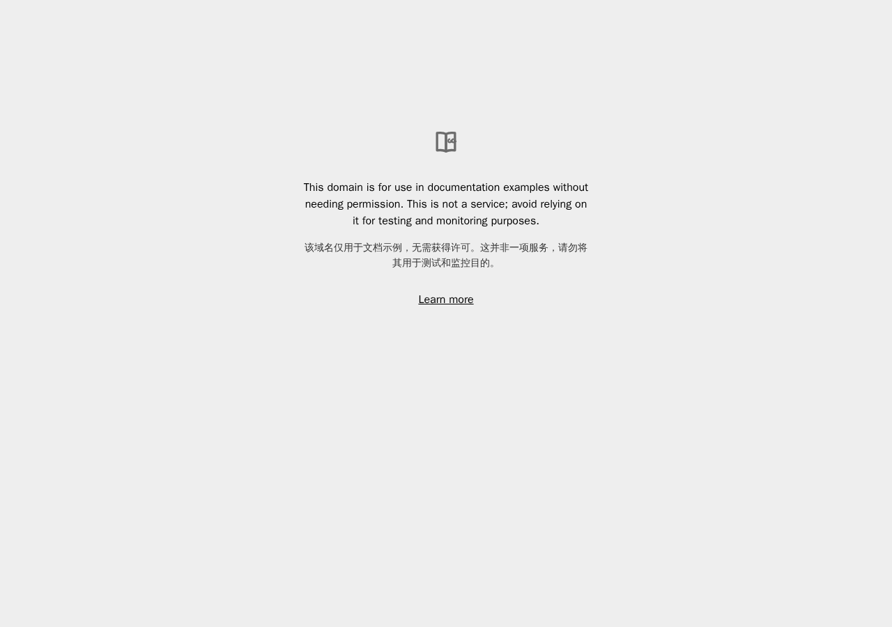

# craft-example-rebuild · 静态网页洁净室复刻

[](https://github.com/yyds8170-ctrl/craft-example-rebuild/actions/workflows/ci.yml)
[](LICENSE)
[](https://github.com/yyds8170-ctrl/craft-example-rebuild/releases/tag/v1.2.0)
[](#验证与证据)

仅依据目标网站的**外部可见行为**（全页截图、实测布局与设计 token）独立写出的静态网页洁净室（clean-room）复刻：不读取其源码，由编码代理从零实现 HTML/CSS，再与原版量化对照、迭代修正。

> **维护者 / Maintainer：洋洋（[yyds8170-ctrl](https://github.com/yyds8170-ctrl)）**
>
> 本仓库是独立的学习 / 研究项目，与目标网站及任何第三方**无隶属、无背书、无赞助关系**；第三方名称与标识归各自权利人，本项目仅作指示性说明。详见 [NOTICE](NOTICE)。



## 特性亮点

- **洁净室实现**：只观察外部可见的截图、坐标与配色，不读取、不复制任何第三方源码。
- **无障碍**：屏幕阅读器标题（`sr-only`）、外部链接 `rel`、SVG `focusable=false`、可见键盘焦点与 `prefers-reduced-motion` 支持。
- **响应式**：桌面端与 390 CSS px 移动端布局均经过渲染对照，内容列与原版对齐。
- **可访问性合规**：正文、链接、注释与图标配色均通过自包含的 WCAG AA 对比度检查（零依赖）。
- **SEO / 元信息**：`meta description`、`theme-color` 与 Open Graph 标签齐备。

## 快速开始

克隆后通过本地静态服务访问：

```bash
git clone https://github.com/yyds8170-ctrl/craft-example-rebuild.git
cd craft-example-rebuild
python3 -m http.server 8000
# 浏览器访问 http://localhost:8000
```

也可直接用浏览器打开 `index.html` 查看静态页面。

## 命令 / 设计 token 参考

### 常用检查命令

```bash
node tests/validate.mjs   # 结构与关键内容校验（19 项）
node tests/contrast.mjs   # WCAG 对比度检查（4 组配色，全部达 AA）
```

### 取证设计 token

| 项目 | 取值 |
| --- | --- |
| 背景色 | `#eeeeee` |
| 正文 / 链接 | `#000000` / `#000ee` |
| 字体 | `system-ui, sans-serif` |
| 字号 | 主文 `16px` / 辅助 `14px` |
| 内容列宽 | `416px` |

## 验证与证据

- **像素对照**：背景色完全一致；内容列水平范围仅差 1–2px；差异像素占比约 **3.5%**，差异主要来自有意精简的多语言内容，而非样式。
- **持续集成**：结构校验、WCAG 对比度检查与 headless 渲染冒烟测试在 GitHub Actions 上持续运行。
- **对照产物**见 `evidence/`：原版 / 复刻截图、差异热力图与图标放大图；本仓库首页截图见 `docs/screenshot.png`。

## 许可证

本项目基于 [PolyForm Noncommercial License 1.0.0](LICENSE) 发布，仅限非商业用途。Copyright (c) 2026 洋洋。
